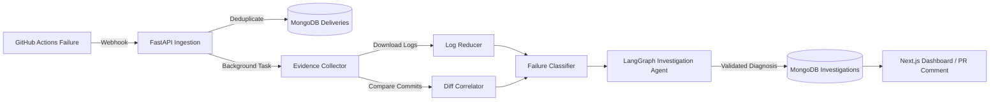

# AutopCI

AutopCI is an autonomous CI failure investigation and postmortem diagnosis system. It collects evidence from failed GitHub Actions runs, deterministically extracts the failing assertions and log excerpts, correlates failures with commit diffs, and runs a bounded AI investigation agent to deliver clear, evidence-backed diagnoses.

- **Deterministic Log Reduction:** Strips ANSI escape codes and runner timestamps, extracts pytest failure summaries, and isolates compact failure packets without LLM noise.
- **Diff & History Correlation:** Locates the previous passing run on the branch, retrieves the commit diff, and correlates failing test files against modified or renamed files.
- **Rule-Based Failure Classification:** Triage engine categorizing failures into `code_bug`, `dependency`, `infra_config`, or `possible_flaky` with heuristic confidence scores.
- **Bounded LangGraph Investigation Agent:** StateGraph diagnostic workflow that reasons over bounded evidence and validates every cited evidence ID to eliminate hallucinations.
- **Multi-Tenant Security:** Sign in with Clerk, link personal or organization GitHub App installations via PKCE OAuth, and enforce scoped membership checks.
- **Interactive Dashboard:** Next.js 15 App Router interface displaying linked installations, monitored repositories, recent workflow runs, diagnostic summaries, and streamed raw logs.

---

## How It Works



1. **Webhook Ingestion & Deduplication:** GitHub sends a signed `workflow_run.completed` failure webhook. FastAPI verifies the HMAC-SHA256 signature and atomically records the delivery in MongoDB to prevent duplicate processing.
2. **Evidence Collection & Log Reduction:** A background task acquires a scoped installation token, fetches failed job metadata, downloads raw logs, and runs the deterministic log reducer to extract `FailurePacket` objects.
3. **Diff Correlation & Context Assembly:** The collector discovers the last successful baseline run on the branch, fetches the commit diff, and identifies whether failing files were modified or renamed.
4. **Classification & AI Diagnosis:** The failure classifier categorizes the root cause (infra, dependency, or code bug). For code bugs, a bounded LangGraph agent reasons over the evidence using a structured LLM, validates evidence citations, and generates a `DiagnosisResult`.
5. **Dashboard & Streaming Logs:** Developers view diagnosis summaries, cited evidence, and commit diffs on the Next.js dashboard, with real-time log streaming directly from GitHub.

---

## Project Structure

| Directory | Role |
| --- | --- |
| [`frontend/`](frontend/) | Next.js 15 App Router, React 19, Tailwind CSS, and Clerk authentication dashboard |
| [`backend/app/agent/`](backend/app/agent/) | LangGraph investigation state graph, evidence formatting, and citation validation |
| [`backend/app/routes/`](backend/app/routes/) | FastAPI endpoints for webhooks, user profiles, installations, and repository investigations |
| [`backend/app/services/`](backend/app/services/) | GitHub auth, API collector, log reduction, context builder, classifier, and investigation service |
| [`backend/app/db/`](backend/app/db/) | MongoDB connection pooling, collection indexes, domain models, and repositories |
| [`backend/app/schema/`](backend/app/schema/) | Pydantic schemas for failure packets, investigation context, and diagnoses |
| [`backend/tests/`](backend/tests/) | Pytest suite covering webhook ingestion, persistence, schemas, and agent flows |

---

## Run Locally

You’ll need **Python 3.12+**, `uv`, **Node.js 20.9+**, `npm`, a reachable **MongoDB** instance, a **Clerk** application, a **GitHub App**, and an **NVIDIA API Key** (for the diagnostic agent).

### 1. Configure Clerk and GitHub

- **Clerk:** Set up your Clerk project. Register a webhook at `https://<backend-host>/webhooks/clerk` subscribed to `user.created`, `user.updated`, and `user.deleted`. Copy the signing secret.
- **GitHub App:** Activate the webhook pointing to `https://<backend-host>/github/webhook`. Grant read permissions to **Actions**, **Metadata**, and **Contents**. Subscribe to **Workflow run** and **Repository**. Set the **Setup URL** and **Callback URL** to `http://localhost:3000/dashboard/github`. Generate and download an RSA private key (`.pem`).

### 2. Configure & Start the Backend

Create `backend/.env` with your credentials:

```dotenv
FRONTEND_URL=http://localhost:3000
MONGODB_URI=mongodb://localhost:27017
MONGODB_DB_NAME=autopci

CLERK_SECRET_KEY=sk_test_...
CLERK_WEBHOOK_SIGNING_SECRET=whsec_...
# CLERK_JWT_KEY=

GITHUB_APP_ID=123456
GITHUB_APP_SLUG=your-app-slug
GITHUB_APP_CLIENT_ID=Iv1...
GITHUB_APP_CLIENT_SECRET=...
GITHUB_PRIVATE_KEY_PATH=secrets/github-app.pem
GITHUB_WEBHOOK_SECRET=your-webhook-secret

# LLM Diagnostic Agent (NVIDIA / LangChain)
NVIDIA_API_KEY=nvapi-...
```

Run the backend server:

```sh
cd backend
uv sync --locked
uv run uvicorn app.main:app --reload --port 8000
```

Verify startup at `http://localhost:8000/health` or view the OpenAPI documentation at `http://localhost:8000/docs`.

### 3. Configure & Start the Frontend

In `frontend/`, copy `.env.example` to `.env.local` and set your Clerk keys:

```dotenv
NEXT_PUBLIC_CLERK_PUBLISHABLE_KEY=pk_test_...
CLERK_SECRET_KEY=sk_test_...
NEXT_PUBLIC_API_URL=http://localhost:8000
```

Run the frontend development server:

```sh
cd frontend
npm ci
npm run dev
```

Open `http://localhost:3000`, sign in, and click **Connect GitHub** to link your repository installations.

---

## API Reference

| Method & Path | Purpose |
| --- | --- |
| `GET /health` | Liveness health check |
| `POST /webhooks/clerk` | Synchronize Clerk user lifecycle events |
| `POST /github/webhook` | Ingest and deduplicate signed GitHub App webhook events |
| `GET /api/users/me` | Fetch authenticated user profile and preferences |
| `GET /api/github/installations` | List GitHub App installations linked to the current user |
| `POST /api/github/installations/authorize` | Initiate GitHub App OAuth authorization with PKCE |
| `POST /api/github/installations/complete` | Complete OAuth callback and resolve accessible installations |
| `POST /api/github/installations/link` | Associate a selected installation with the user's workspace |
| `GET /api/github/repositories` | List authorized repositories with recent run histories and statuses |
| `GET /api/github/repositories/{repo_id}/runs` | List recorded workflow runs for a repository |
| `GET /api/github/repositories/{repo_id}/runs/{run_id}/attempts/{attempt}` | Fetch detailed attempt evidence, classification, and diagnosis |
| `GET /api/github/repositories/{repo_id}/runs/{run_id}/attempts/{attempt}/jobs/{job_id}/log` | Stream complete raw job log from GitHub to the client |

---

## Testing

Run backend tests and linters from `backend/`:

```sh
uv run pytest
uv run ruff check .
```

Run frontend linting and type checks from `frontend/`:

```sh
npm run lint
npm run build
node --test lib/api.test.mjs
```

---

## License

[MIT](LICENSE)
